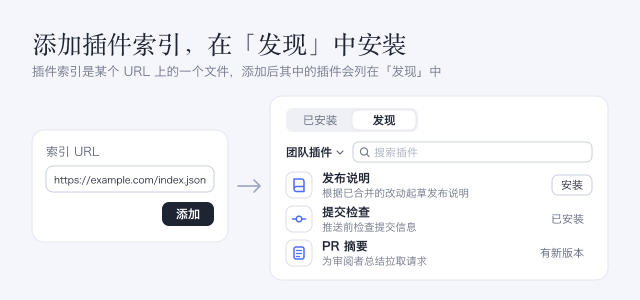

团队把插件发布到插件市场索引中，添加该索引的人都能在 DSH 中安装这些插件。DSH 没有内置插件市场。

## 使用方法

- 打开 **插件**，选择 **发现**，点击 **添加索引源**，输入插件市场的 **索引 URL**，然后点击 **添加**。之后要添加其他插件市场，请打开插件市场菜单并选择 **管理索引源…**。
- 点击一个插件可阅读它的详细介绍，然后点击 **安装** 并确认。
- 已安装的插件会显示 **已安装**；当插件市场推荐更新的版本时显示 **有新版本**。点击它可在 **已安装** 中打开该插件。

## 注意事项

- 只有在你添加插件市场之后，DSH 才会连接它。
- 插件市场中的插件来自第三方，并以你的权限运行。只添加你信任的插件市场。
- 要更新从 npm 安装的插件，请在 **已安装** 中该插件的 **版本** 区域使用 **更新**；卸载之前，从插件市场安装另一个 npm 版本会失败。从 Git 安装的插件没有 **版本** 区域；要更换它的版本，请先卸载，再从插件市场重新安装。
- 插件的详细介绍来自公共 npm 文件服务（jsDelivr、unpkg、npmmirror）或插件的 Git 仓库，读取私有仓库时使用你的 Git 凭据。图标直接从索引中给出的地址加载，因此这些服务器会看到你的 IP 地址。
- 在 **创造模式** 下，智能体还会获得只读的 `plugin_market` 工具，这会让每次请求多消耗少量 token。
- 关闭此插件会移除 **发现** 和 `plugin_market` 工具；你的索引源和已安装的插件都会保留。
