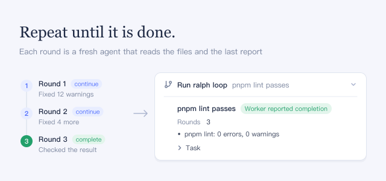

New agents work on one goal round after round until one reports it done. Each round's agent sees only the goal, the workspace files, and the previous round's short report, not the conversation.

## How to use

- Ask for it by name and give a goal an agent can check from the files, for example: "Run a Ralph loop until pnpm lint passes with zero warnings. Give it at most 5 rounds."
- The loop appears in the conversation as **Run ralph loop**, marked **Worker reported completion**, **Worker reported a blocker**, or **Round limit reached**. Expand it to see the last report, **Rounds**, any **Remaining work**, and the **Task**.

## Good to know

- Agents are told to use it only when you ask for a Ralph loop or for repeated work with fresh agents.
- Completion and blockers are the last agent's own report. Check the result yourself.
- Anything a round does not write to the files or its report is lost. A round without a valid report stops the loop with an error.
- The conversation waits for the whole loop. Stopping the reply stops the loop.
- A loop runs at most 64 rounds; asking for more fails. Each round is a full agent run, so cost grows with each round.
- Turning the plugin off removes the loop from every agent's next request.
